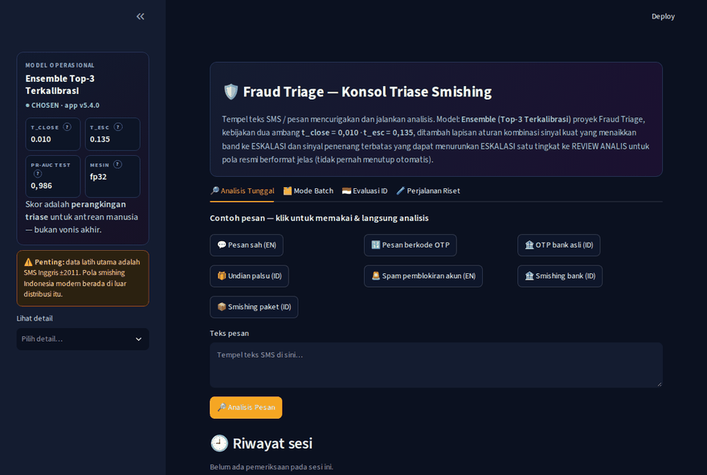
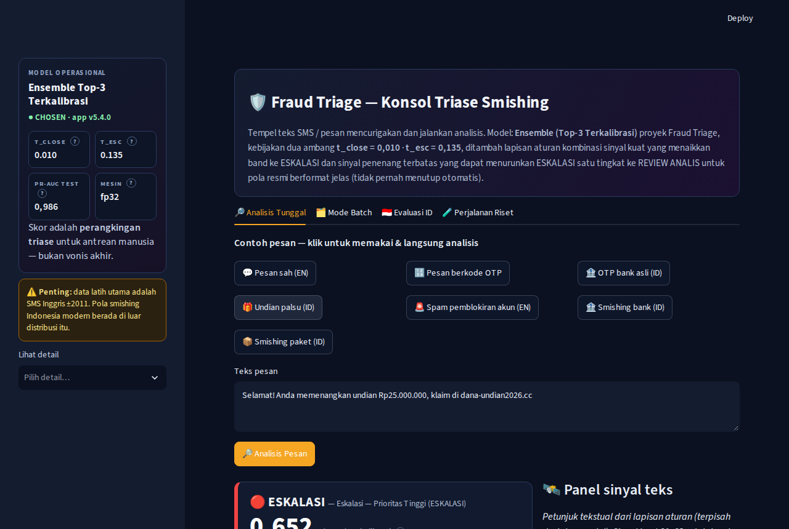
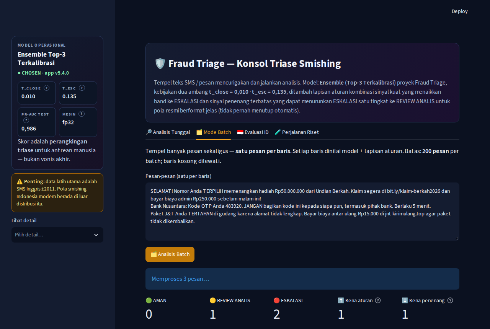
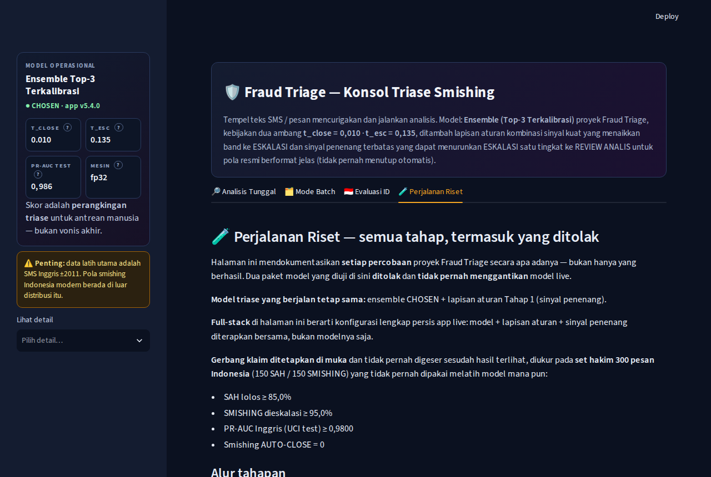
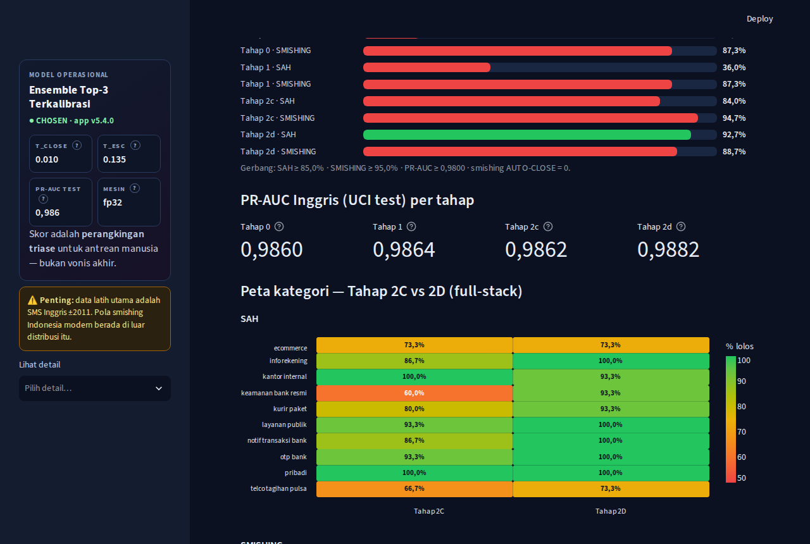

# 🛡️ Fraud Triage — Aplikasi Triase Smishing (Streamlit)

**Demo live: [fraud-triage-demo.streamlit.app](https://fraud-triage-demo.streamlit.app/)**
· Model: [Hugging Face `rwnliwan/fraud-triage-smishing`](https://huggingface.co/rwnliwan/fraud-triage-smishing)
· Notebook proyek: `fraud-triage-laya-vs-ml-dl.ipynb` (arsip riset lengkap Tahap 0–2D)
· 📄 Dokumen proyek (edisi v2): [Laporan Lengkap Proyek (PDF)](docs/laporan-lengkap-proyek.pdf) · [Presentasi LinkedIn (PDF)](docs/presentasi-linkedin.pdf)
· 👤 Penulis: [Septian Panjaya — LinkedIn](https://www.linkedin.com/in/septian-panjaya)

## 🏘️ Siskamling Digital — layanan publik (live)

Sejak Oktober 2026 app ini juga adalah rumah **Siskamling Digital**,
layanan publik **lapor & cek smishing** untuk warga Indonesia —
tab pertama yang menyambut pengunjung:

- **📮 Lapor & Cek** — tempel pesan mencurigakan → vonis bahasa awam
  (🔴 hampir pasti penipuan / 🟡 mencurigakan / 🟢 kemungkinan aman)
  + langkah tindakan; laporkan agar warga lain terlindungi. Teks
  dibersihkan otomatis dari data pribadi sebelum disimpan; pengirim
  hanya disimpan sebagai hash satu arah.
- **🖼️ Galeri Modus** — modus terverifikasi yang bisa disaring per
  kategori, untuk mengenali pola sebelum jadi korban.
- **🔐 Verifikasi** (admin, gerbang kata sandi) — label akhir selalu
  diputuskan **manusia**; model hanya menyaring & memberi saran.
  Panel analitik + progres korpus menuju retrain di tab yang sama.
- **Perlindungan layanan** — batas laju per pengirim/harian, pemutus
  antrean, kill switch intake, deteksi duplikat, monitor lonjakan,
  dan Cloudflare Turnstile terpasang dorman (aktif saat dibutuhkan).

Misi datanya: membangun **korpus smishing Bahasa Indonesia berlabel
manusia** — riset proyek ini menemukan belum ada korpus publik
semacam itu. Detail fase & desainnya ada di riwayat commit (v5.5–v5.9).

## 🎬 Demo



*Alur demo: contoh smishing → kartu ESKALASI + panel sinyal → Mode Batch
(antrean prioritas) → Perjalanan Riset (alur 6 tahap + heatmap kategori).*

| Analisis Tunggal | Mode Batch |
|---|---|
|  |  |

| Perjalanan Riset | Heatmap kategori 2C vs 2D |
|---|---|
|  |  |

## 🎯 Pemanfaatan model ini

Pola yang bisa dipakai ulang hari ini adalah **mesin mengurutkan,
manusia memutuskan**: skor terkalibrasi mengurutkan antrean triase
pesan mencurigakan (bank/fintech, CS e-wallet/telco, pusat pengaduan),
lapisan aturan deterministik menjaga kasus paling berbahaya, dan
manusia tetap pemegang vonis. **Bobot modelnya sendiri belum siap
produksi** — klaim Indonesianya gagal 2 dari 4 gerbang yang dikunci
di muka dan data latihnya SMS Inggris ±2011; naik produksi butuh
korpus Indonesia segar berlabel, kalibrasi ulang, dan pemantauan
drift. Uraian lengkapnya ada di laporan PDF proyek.

Aplikasi penyaji model terpilih proyek **Fraud Triage**: **Ensemble (Top-3
Terkalibrasi)** dengan kebijakan dua ambang operasional **t_close = 0,010**
dan **t_esc = 0,135** (Bagian 10 notebook `fraud-triage-laya-vs-ml-dl.ipynb`).
Tujuh tab (urutan warga-dulu sejak v5.9): **Lapor & Cek** dan
**Galeri Modus** (Siskamling Digital, lihat di atas), lalu konsol
riset: **Analisis Tunggal**, **Mode Batch**, **Evaluasi ID** (panel 16
pesan + simulator ambang interaktif), **Perjalanan Riset** (kronik
Tahap 0–2D dengan heatmap per kategori), dan **Verifikasi** (admin). Sidebar ringkas: kartu status
model + dropdown "Lihat detail" (komposisi, aturan, keterbatasan,
benchmark arena, tautan).

Pengguna menempel teks SMS → app menampilkan probabilitas scam terkalibrasi,
keputusan triase (AMAN / Review Analis / Eskalasi) pada kartu hasil berwarna
dengan bilah skor visual terhadap kedua ambang, skor per anggota ensemble,
penjelasan faktor teks (kata pendorong + fitur angka), **panel sinyal** yang
terdeteksi dari teks, dan **lapisan aturan** keamanan di atas model.

Fitur app: analisis tunggal dengan contoh siap-klik (termasuk contoh OTP
bank asli), **mode batch** (satu pesan per baris → tabel + ringkasan per
band), **riwayat sesi**, dan sidebar info model dengan keterbatasan yang
jujur. Tema gelap "fraud ops console" diatur di `.streamlit/config.toml`
plus CSS kustom di `app.py`.

**Baru di v4** (Tahap 1 perbaikan Indonesia — **sinyal penenang**):

- Baseline Tahap 0 (set evaluasi Indonesia v1, 300 pesan berlabel)
  membuktikan model mengeskalasi **84% pesan sah** Indonesia (sah lolos
  hanya **16,0%**) — penyakitnya register formal institusional yang tak
  pernah ada di data latih UCI Inggris ±2011, bukan lapisan aturan
  (aturan 0× terpicu pada pesan sah).
- `rules.py` kini punya **sinyal penenang**: pola resmi berformat sangat
  jelas (OTP standar tanpa tautan; tautan hanya ke domain resmi persis;
  notifikasi transaksi terstruktur tanpa tautan) menurunkan band
  ESKALASI model **tepat satu tingkat** ke REVIEW ANALIS. Tidak pernah
  AUTO-CLOSE, tidak mengubah skor, gugur total bila S2/S3 aktif atau
  aturan terpicu. Hasil terukur & desain finalnya: bagian "Sinyal
  penenang" di bawah.
- Kartu hasil menampilkan lencana ⬇️ penenang + alasannya; panel sinyal,
  tabel batch/riwayat, dan ekspor CSV memuat kolom penenang.

**Baru di v3** (menutup kritik atas v2):

- **Ekspor CSV** untuk tiga hal: hasil batch, riwayat sesi, dan log
  koreksi (kolom: teks dipotong aman, skor, band model, band final,
  aturan terpicu, sinyal aktif).
- **Batch yang layak kerja**: bilah progres per pesan ("Menilai i dari
  N"), batas **200 baris** ditegakkan (baris kosong dilewati; di luar
  batas ditolak dengan pesan jelas, tidak ada yang diproses diam-diam).
  Engine publik hanya menilai per teks, jadi batch berjalan sekuensial
  dengan progres.
- **Batas input tunggal 2.000 karakter** — teks lebih panjang dipotong
  dan peringatan ditampilkan.
- **Tombol koreksi** di bawah hasil tunggal: pengguna memilih band yang
  benar menurutnya; tercatat di **log koreksi sesi** (dengan unduh CSV).
  Jujur apa adanya: log ini hidup **hanya di sesi browser (demo)** —
  tidak ada penyimpanan permanen dan tidak terkirim ke mana pun.
- **Tab 🇮🇩 Evaluasi ID**: set uji kecil buatan 16 pesan Indonesia
  berlabel harapan yang dijalankan apa adanya — lihat hasilnya di bawah.
- **Kalimat penjelasan vonis** pada kartu hasil + footer berisi versi
  app dan tautan repo/model.

## 🏘️ Siskamling Digital (v5.5.0 — Fase 1)

App ini kini juga menjadi **Siskamling Digital** — layanan ronda warga
untuk pesan penipuan — dengan mesin Fraud Triage yang sama:

- **📮 Lapor & Cek** — warga menempel pesan, menerima hasil cek awal,
  dan dapat mengirim laporan. Setiap laporan tercatat dengan **nomor
  laporan unik** dan **tanggal submit** di basis data Turso khusus
  (terpisah dari proyek lain). Teks hanya disimpan **setelah
  dibersihkan dari data pribadi** (`scrubber.py`); nomor pengirim
  hanya disimpan sebagai **hash satu arah bergaram**, tidak pernah
  dalam bentuk asli. Persetujuan penggunaan data bersifat dua tingkat
  (teks persetujuan v1) dan tercatat di log persetujuan; tanpa
  persetujuan, laporan hanya dipakai untuk cek & verifikasi.
- **🖼️ Galeri Modus** — hanya menampilkan laporan yang **sudah
  diverifikasi manusia** dan disetujui tampil. Laporan baru berstatus
  *menunggu verifikasi* dan tidak tampil di galeri maupun korpus data.
- **🔐 Verifikasi** (Fase 2, v5.6.0) — ruang kerja peninjau terkunci
  kata sandi. Antrean laporan pending terurut risiko, lengkap dengan
  **saran** label & kategori modus dari model — tetapi **label akhir
  selalu ditentukan manusia**, agar korpus berisi penilaian yang
  independen dari model. Dari sini laporan diverifikasi (masuk korpus
  bila ada consent; opsional tampil di galeri), ditolak, dihapus, atau
  dikembalikan ke antrean. Panel **📊 Analitik** di tab yang sama
  (v5.7.0) menampilkan total & tren laporan harian, corong status,
  tingkat consent, pengirim unik/berulang, rata-rata waktu verifikasi,
  progres korpus per label menuju target ±1.000 (retrain Tahap 3), dan
  kategori modus terbanyak — semua dari data laporan, **bukan** jumlah
  views halaman (app tidak dapat menghitung penontonnya sendiri).
  **Fase 2.5 Hardening** (v5.8.0): kill switch penerimaan laporan di
  tabel `app_config` (tombol di tab Verifikasi; keadaan darurat juga
  bisa dibalik langsung di basis data), batas laju 10 laporan per
  pengirim per hari + 300 per hari + pemutus antrean pada 500 pending,
  jeda 20 detik antar-kirim per sesi, dan kolom `text_hash` (sidik
  teks ternormalisasi) untuk deteksi duplikat. Monitor lonjakan
  (30 menit) dan ekspor cadangan mingguan berjalan di sisi pengelola.
  **UI/UX Opsi A + Turnstile dorman** (v5.9.x): tab Lapor & Cek menjadi
  halaman mendarat, hero warga + vonis bahasa awam (detail teknis
  dilipat ke expander), saringan kategori di galeri; Cloudflare
  Turnstile terpasang dorman lewat komponen `turnstile_component/` —
  aktif hanya bila kedua kunci terpasang di secrets DAN
  `app_config.turnstile_on='1'` (verifikasi widget dilakukan
  terkendali di app live sebelum flag dinyalakan untuk warga).

Konfigurasi deploy (Streamlit Cloud → Settings → Secrets — nilai
**tidak pernah** masuk repo/git): `TURSO_DATABASE_URL`,
`TURSO_AUTH_TOKEN`, `SISKAMLING_SENDER_SALT`,
`SISKAMLING_ADMIN_PASSWORD`. Tanpa secrets Turso, tab Lapor & Cek
tetap bisa dipakai untuk cek, tetapi laporan tidak tersimpan dan
galeri tidak aktif; tanpa kata sandi admin, tab Verifikasi tidak
aktif.

## Lapisan aturan (rules layer)

Di atas skor model ada lapisan aturan deterministik (`rules.py`, murni
regex, tanpa dependensi ML) yang dirancang konservatif:

- **Kombinasi, bukan kata tunggal.** Tiga sinyal kuat: **S1** ada tautan
  (URL) — terutama pemendek/domain tak resmi; **S2** permintaan memasukkan
  OTP/PIN/kredensial atau bertindak lewat tautan; **S3** ancaman
  blokir/suspensi/hangus **disertai** urgensi waktu. Aturan terpicu hanya
  bila **≥ 2 sinyal kuat hadir bersamaan**.
- **Hanya menaikkan.** Bila terpicu, band final dipaksa ke ESKALASI berapa
  pun skor modelnya. Aturan **tidak pernah menurunkan** band dan **tidak
  mengubah skor** — pesan yang model anggap berisiko tidak bisa ditutup
  oleh aturan.
- **Tidak salah tembak ke pesan sah.** Kalimat pelindung khas bank
  ("JANGAN bagikan/berikan kode ini kepada siapa pun") secara eksplisit
  bukan sinyal S2: kata kerja meminta-masukkan tidak mencakup
  "berikan/bagikan", dan kecocokan yang didahului "jangan" dibuang.
  Contoh "🏦 OTP bank asli (ID)" di app mendemonstrasikan ini: aturannya
  diam; apa pun band-nya datang murni dari model.
- **Transparan.** Bila aturan menaikkan band, kartu hasil menampilkan
  lencana "Aturan terpicu" berisi sinyal-sinyalnya; panel sinyal selalu
  menampilkan hitungan sinyal kuat yang aktif.

## Sinyal penenang (v4 — Tahap 1 perbaikan Indonesia)

Arah sebaliknya dari lapisan aturan, dirancang sama konservatifnya.
Latarnya terukur: pada **set evaluasi Indonesia v1** (300 pesan
berlabel: 150 sah / 150 smishing, 20 kategori × 15 — folder
`../id-eval-set/`), app v3 hanya meloloskan **16,0% pesan sah**
(126/150 dieskalasi **model sendiri**; median skor sah 0,471 justru di
atas median smishing 0,402), sementara smishing tertangkap **87,3%**
dan **0** smishing sampai AUTO-CLOSE.

Tiga pola penenang (`evaluate_calm()` di `rules.py`):

- **P1 — format OTP standar**: kode OTP/verifikasi + frasa penjaga
  ("jangan bagikan/berikan …") dan **tanpa tautan sama sekali**.
- **P2 — domain resmi persis**: setiap tautan dalam pesan host-nya
  cocok **persis** dengan daftar domain resmi terkurasi (17 domain:
  bank besar, telco, kurir, e-commerce Indonesia; subdomain resmi hanya
  bila berakhiran domain itu persis — domain siluman seperti
  `bca.co.id.evil.com` tidak lolos).
- **P3 — notifikasi transaksi terstruktur tanpa tautan**: nominal Rp +
  penanda pernyataan (pernyataan saldo / nomor referensi / "berhasil"
  transaksional) — dan **gugur bila ada umpan hadiah** dalam teks.

Mekanik keras: penenang hanya bekerja pada band **model** ESKALASI dan
menurunkannya **tepat satu tingkat** ke REVIEW ANALIS; **tidak pernah**
menghasilkan AUTO-CLOSE; skor tidak berubah; **gugur total** bila
sinyal kuat S2/S3 aktif atau aturan keamanan terpicu (pesan yang
dinaikkan aturan tidak bisa diturunkan — arah naik selalu menang).

Hasil terukur (jalur engine app yang sama, sebelum → sesudah):

| Ukuran (set 300) | v3 | v4 |
|---|---|---|
| Sah lolos | 16,0% (24/150) | **36,0% (54/150)** |
| Smishing dieskalasi | 87,3% (131/150) | **87,3% (131/150)** |
| Smishing AUTO-CLOSE | 0 | **0** |
| Total lolos | 51,7% (155/300) | **61,7% (185/300)** |

Kategori sah yang terangkat: notifikasi transaksi bank 0→12/15, info
rekening 0→8/15, OTP bank 0→5/15, kurir paket 0→2/15, e-commerce
4→6/15, telco 1→2/15. **0 smishing tersentuh penenang** pada desain
final — iterasi pertama P3 (kata kunci lepas) sempat menenangkan 3
smishing (87,3%→85,3%) karena "saldo"/"berhasil" juga dipakai sebagai
umpan; penanda kontekstual + veto umpan hadiah menutupnya tanpa
mengurangi keuntungan pesan sah. Panel 16 pesan app: sah **1/8 → 3/8**,
smishing tetap **8/8** (target internal panel ≥4/8 belum tercapai —
bank panel fiktif sehingga P2 tak bisa menyala, dan frasa tagihan/
e-statement di luar penanda P3; dilaporkan apa adanya).

**Batas jujur:** penenang hanya menolong pola berformat jelas (±36%
pesan sah pada set ini). Over-eskalasi model pada teks Indonesia bebas
tetap ada — obatnya fine-tune dwibahasa dengan data Indonesia berlabel
(Tahap 2), bukan aturan tambahan.

---

## Perjalanan riset — Tahap 0 s.d. 2D (ringkasan jujur)

App ini adalah ujung dari busur riset yang didokumentasikan penuh di
notebook (Bagian 14–17) dan tab **🧪 Perjalanan Riset** di dalam app.
Klaim "9/10" untuk triase smishing Indonesia diuji dengan **gerbang yang
ditetapkan di muka** pada set hakim 300 pesan (150 sah / 150 smishing)
yang tidak pernah jadi data latih:

| Tahap | Intervensi | Sah | Smishing | Smishing AUTO-CLOSE | UCI PR-AUC | Vonis |
|---|---|---|---|---|---|---|
| 0 | Baseline full-stack | 16,0% | 87,3% | 0 | 0,986 | Penyakit terdiagnosis: register formal-institusional ID tak dikenal model |
| 1 | Sinyal penenang (aturan) | 36,0% | 87,3% | 0 | 0,986 | Diterima sebagai app v4 — tambal terukur |
| 2C | Fine-tune dwibahasa DistilBERT | 84,0% | 94,7% | **3** | 0,986 | **DITOLAK** — gagal tipis di tiga gerbang sekaligus |
| 2D | Loop perbaikan data (satu-satunya) | **92,7%** | 88,7% | **2** | 0,988 | **DITOLAK** — 2/4 gerbang; klaim 9/10 tidak tercapai |

Gerbang: sah ≥ 85% · smishing ≥ 95% · smishing AUTO-CLOSE = 0 · UCI
PR-AUC ≥ 0,98. Sesuai doktrin yang dikunci sebelum hasil diketahui —
satu loop perbaikan lalu dokumentasikan apa adanya — **model app TIDAK
ditukar** dan penalaan dihentikan: set hakim sudah diamati berulang
(menala ke arahnya = overfitting), dan riset ketersediaan dataset
(Oktober 2026) membuktikan bottleneck-nya struktural — **hanya ada satu
korpus SMS Indonesia asli yang publik (1.143 baris, 3 kelas, era
2013–2015) dan nol dataset smishing Indonesia publik**, sementara modus
modern (APK via WhatsApp, pinjol, judol) tidak punya contoh berlabel
sama sekali. Hasil negatif ini disajikan apa adanya karena rigor
evaluasinya adalah nilai proyek ini.

---

## Panel evaluasi Indonesia (v3) — hasil apa adanya

Tab 🇮🇩 Evaluasi ID menjalankan **16 pesan buatan** (8 sah, 8 smishing;
nama bank fiktif "Bank Nusantara"/"Bank Sentosa", domain mencurigakan
fiktif) yang **dikunci di kode sebelum pertama kali dijalankan**. Ini
**bukan benchmark** — hanya panel transparansi. Definisi "sesuai": sah →
band final AUTO-CLOSE/REVIEW; smishing → band final ESKALASI.

Hasil run pertama (dan run UI sesudahnya identik):

| Kelompok | Sesuai | Catatan |
|---|---|---|
| Pesan SAH | **1/8** | Hanya pesan pribadi (0,009 → AUTO-CLOSE) yang tidak dieskalasi. Tujuh pesan sah lain — OTP bank asli (0,462), notifikasi transaksi (0,729), tagihan telekomunikasi (0,546), kurir wajar (0,655), notifikasi keamanan bank (0,561), e-statement (0,682), undangan rapat (0,267) — semuanya di-ESKALASI **oleh model sendiri**; lapisan aturan tidak pernah memicu pada pesan sah. |
| SMISHING | **8/8** | Semua mencapai ESKALASI; 4 di antaranya dibantu lapisan aturan (S1+S2 atau S1+S2+S3), 4 sisanya murni skor model. |

**Bacaan jujurnya:** pada set kecil ini model sangat agresif terhadap
teks Indonesia — smishing tertangkap semua, tetapi presisi pada pesan
sah Indonesia buruk (over-eskalasi), konsisten dengan keterbatasan data
latih UCI SMS Inggris ±2011. Panel ini sengaja menampilkan kegagalan
itu, bukan menyembunyikannya; memperbaikinya butuh data latih/evaluasi
Indonesia berlabel yang sesungguhnya, bukan penyesuaian pesan uji.

## Uji float16 (v3) — TIDAK diadopsi

DistilBERT diuji dalam dua dtype (cast saat muat lokal, repo HF tidak
diubah; CPU, 4 probe resmi + latensi 5 pesan × 3 putaran):

| Ukuran | fp32 | fp16 (cast) |
|---|---|---|
| Skor probe (undian / ham / OTP / spam) | 0,652 / 0,012 / 0,293 / 0,220 | 0,652 / 0,012 / 0,293 / 0,220 (selisih maks **0,000053**) |
| Band probe | sama persis | sama persis |
| Bobot BERT | 541,3 MB | 270,7 MB |
| Latensi per pesan | **114,7 ms** | **179,5 ms (+56%)** |

Aturan adopsi yang ditetapkan sebelumnya: band probe sama DAN selisih
skor ≤ 0,005 DAN latensi tidak memburuk > 25%. fp16 lolos dua syarat
pertama tetapi **gagal syarat latensi** (CPU tidak punya akselerasi
fp16 untuk model ini), jadi **app tetap fp32**. Penghematan memori
271 MB tidak ditukar dengan inferensi 56% lebih lambat.

---

## Isi folder

| Berkas | Fungsi |
|---|---|
| `app.py` | Antarmuka Streamlit **v5.4.0** (Bahasa Indonesia, istilah teknis English): analisis tunggal (batas 2.000 char, kalimat vonis, tombol koreksi + log koreksi sesi), mode batch sebagai **antrean prioritas** (terurut skor tertinggi, detail per kasus, unduh laporan kasus .md; batas 200 baris), ekspor CSV (batch/riwayat/koreksi), tab evaluasi ID + simulator ambang, tab perjalanan riset (heatmap dua chart SAH/SMISHING), riwayat sesi, panel sinyal, bilah skor, lencana sinyal penenang, sidebar ringkas (kartu status + benchmark kartu + dropdown detail), CSS responsif mode phone (media query ≤640px/≤480px) |
| `journey.py` + `results.json` + `gen_results.py` | Tab 🧪 Perjalanan Riset: kronik Tahap 0–2D, diagram gerbang, heatmap kategori 2C vs 2D. `results.json` DIGENERATE oleh `gen_results.py` dari file evaluasi terverifikasi — tidak diketik manual |
| `triage_core.py` | Logika model murni (tanpa Streamlit): ensemble, kalibrasi temperatur, kebijakan dua ambang, penjelasan faktor |
| `rules.py` | Lapisan aturan murni regex (tanpa Streamlit): deteksi sinyal teks + aturan kombinasi ≥2 sinyal kuat yang memaksa ESKALASI (hanya menaikkan) + sinyal penenang terbatas (P1/P2/P3) yang menurunkan ESKALASI model satu tingkat ke REVIEW untuk pola resmi berformat jelas |
| `.streamlit/config.toml` | Tema gelap "fraud ops console" (warna dasar, aksen amber) |
| `build_artifacts.py` | Skrip pembangunan artefak deploy dari resep notebook + verifikasi angka (sudah dijalankan; jalankan ulang hanya bila resep berubah) |
| `requirements.txt` | Dependensi (torch diarahkan ke wheel CPU) |
| `model/ensemble_spec.json` | Spesifikasi ensemble: anggota, temperatur per anggota, ambang kebijakan (salinan lokal; di cloud diunduh dari Hugging Face) |
| `model/sklearn_members.joblib` | Dua anggota sklearn yang dilatih ulang persis dari resep notebook (pipeline LR + komponen model fitur) — berkas biner, **tidak ikut repo GitHub**; di cloud diunduh dari Hugging Face |
| `model/model_operasional.pkl` | Salinan artefak resmi proyek — isinya **spesifikasi** ensemble (nama anggota + temperatur), sumber kebenaran `ensemble_spec.json` |
| `model/bert/` | *(opsional, lokal saja)* tempat bobot DistilBERT fine-tune bila ingin menimpa sumber cloud |

## Cara model dimuat (penting, jujur apa adanya)

Artefak resmi proyek `data/model_operasional.pkl` **bukan** model yang bisa
dijalankan — sesuai desain Bagian 13.5 notebook, isinya hanya spesifikasi
ensemble karena di notebook ensemble "disajikan" dari anggota yang hidup di
memori kernel. Karena itu artefak deploy dibangun begini:

1. **Dua anggota sklearn** (TF-IDF + LR dan TF-IDF + Fitur Angka + LR)
   dilatih ulang oleh `build_artifacts.py` dari data & split yang **persis
   sama** dengan notebook (UCI SMS Spam, dedup, stratified 60/20/20,
   seed 42, resep hyperparameter identik; remediasi Bagian 4.7 terbukti
   tidak mengubah LR — yang dituning GBM dan tidak membaik).
2. **Anggota DistilBERT** tidak dilatih ulang: bobot fine-tune-nya memang
   sudah tersimpan sejak notebook di `data/bert_snapshot` (dibekukan di
   gerbang memori Bagian 7). App memuatnya dari salah satu sumber ini
   (urutan di `triage_core.resolve_bert_source`): variabel lingkungan
   `BERT_MODEL_PATH` → folder `model/bert/` → `data/bert_snapshot` proyek
   (mode dev lokal) → `BERT_MODEL_ID` (repo Hugging Face) → repo artefak
   bawaan (di bawah).
3. **Jalur cloud (bawaan deploy)**: seluruh artefak yang dibutuhkan app —
   `ensemble_spec.json`, `sklearn_members.joblib`, dan bobot DistilBERT
   (config + `model.safetensors` + tokenizer) — terunggah di repo model
   Hugging Face **publik** `rwnliwan/fraud-triage-smishing`. Resolusi
   selalu lokal-dulu; bila berkas lokal tidak ada (kondisi normal di
   Streamlit Cloud, karena repo GitHub hanya berisi kode), artefak
   diunduh dari repo itu tanpa token. Repo sumber bisa diganti lewat
   env/secrets `ARTIFACT_REPO_ID`.
4. **Verifikasi pembangunan**: PR-AUC hasil bangun ulang cocok dengan
   angka resmi notebook — LR val 0,968 · Fitur val 0,969 · BERT val 0,978 ·
   Ensemble val 0,982 · **Ensemble test 0,986**.

Skor akhir = rata-rata probabilitas terkalibrasi ketiga anggota
(temperatur: BERT 1,184 · Fitur 0,926 · LR 0,614; temperatur ensemble 1,0
by design), lalu dipetakan ke zona kebijakan.

## Menjalankan lokal

```bash
cd fraud-triage-laya/streamlit-app
../.venv/bin/streamlit run app.py
# tanpa konfigurasi apa pun, app otomatis memakai ../data/bert_snapshot
```

Uji inti tanpa UI:

```bash
../.venv/bin/python -c "
from triage_core import TriageEngine
e = TriageEngine()
print(e.triage('URGENT: your account will be blocked today, verify PIN at secure-login-verify.xyz')['p_scam'])
"
```

## Deploy ke Streamlit Community Cloud

Seluruh artefak model sudah terunggah di repo Hugging Face publik
**`rwnliwan/fraud-triage-smishing`** dan repo GitHub hanya berisi kode —
jadi deploy tidak lagi butuh penempatan bobot manual.

### Langkah 1 — Repo GitHub

Repo GitHub berisi isi folder `streamlit-app/` ini sebagai root
(`app.py`, `triage_core.py`, `rules.py`, `build_artifacts.py`,
`requirements.txt`, `README.md`, `.streamlit/config.toml`,
`model/ensemble_spec.json`). Berkas biner
(`sklearn_members.joblib`, bobot BERT) **sengaja tidak** ikut repo —
app mengunduhnya dari Hugging Face saat pertama jalan.

### Langkah 2 — Buat app di Streamlit Community Cloud

1. Buka **share.streamlit.io** → *Sign in with GitHub*.
2. Klik **New app** → pilih repo GitHub itu, branch `main`,
   *Main file path*: `app.py`.
3. (Opsional, di *Advanced settings*) Python 3.12.
4. **Secrets TIDAK wajib diisi** — model otomatis diambil dari repo
   Hugging Face publik bawaan. Override hanya bila perlu mengganti
   sumber artefak: `ARTIFACT_REPO_ID = "<user>/<repo-model-lain>"`
   (atau `BERT_MODEL_ID` khusus untuk bobot DistilBERT saja).
5. Klik **Deploy** dan tunggu build pertama selesai (tarik torch CPU +
   transformers, lalu unduh model ±541 MB dari Hugging Face;
   beberapa menit).

### Langkah 3 — Verifikasi pasca-deploy

Klik contoh **"🎁 Undian palsu (ID)"** → keputusan harus **ESKALASI**
(skor ±0,65); contoh **"💬 Pesan sah (EN)"** → **REVIEW ANALIS**
(skor ±0,012). Bila app gagal memuat model, pesan error di app menyebut
sumber artefak yang dicari — periksa repo `ARTIFACT_REPO_ID` yang aktif
(bawaan: `rwnliwan/fraud-triage-smishing`).

### Catatan sumber daya

Tier gratis Streamlit Cloud memberi RAM ±1 GB. DistilBERT multilingual
fp32 memakai 541,3 MB bobot; app ini sudah teruji memuat & memprediksi
di CPU. Opsi float16 **sudah diuji di v3 dan tidak diadopsi** — bobot
memang separuh (270,7 MB) dan skor praktis identik, tetapi latensi CPU
memburuk +56% (lihat bagian "Uji float16" di atas). Bila suatu saat
deploy kena batas RAM, opsi tindak lanjutnya adalah membatasi beban
dengan cara lain (mis. antrean/pembatasan laju), bukan menurunkan
presisi angka model.

---

*Model ini artefak proyek pembelajaran terpimpin (data SMS Inggris ±2011);
bukan sistem produksi perbankan. Vonis lengkap metode — termasuk posisi
Laya sebagai kandidat lapisan teks, bukan model operasional — ada di
notebook proyek.*
